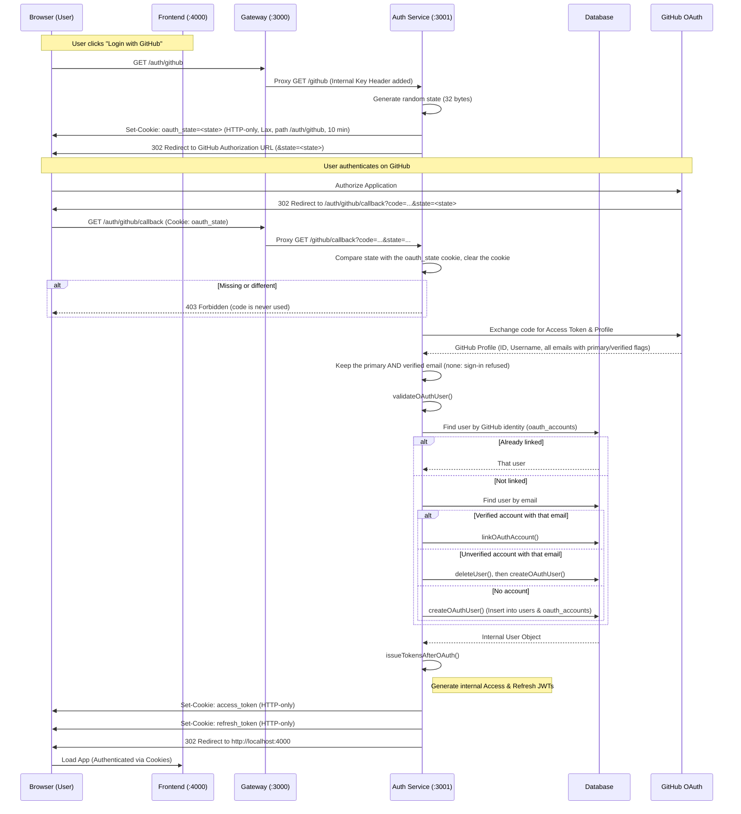
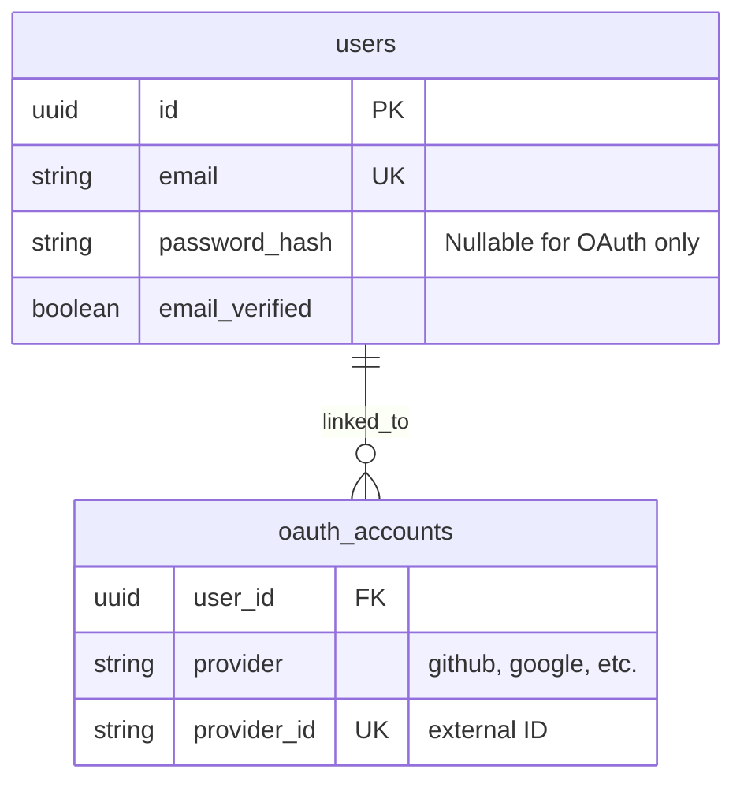

# OAuth Authentication Flow

This document describes the exact sequence of events for GitHub OAuth authentication in the Matcha application.

## Architecture Components
- **Frontend**: `http://localhost:4000`
- **API Gateway**: `http://localhost:3000` (Proxies `/auth/*` to Auth Service)
- **Auth Microservice**: `http://localhost:3001`
- **GitHub OAuth**: External Identity Provider

## Sequence Flow

## Implementation Details

### 1. Strategy
`GithubStrategy` (`backend/apps/auth/src/strategies/github.strategy.ts`) extends Nest's `PassportStrategy` over `passport-github2`. Its `validate()` returns the user (or throws); Nest hands the result to passport, so `validate()` must never call passport's `done()` itself.

Options that matter for security:
- `allRawEmails: true`: passport-github2 otherwise keeps only the primary email **without checking that GitHub verified it**. With it, every address comes with GitHub's `primary` / `verified` flags, and only the one that is both is used.
- `store: cookieStateStore`: the `state` check described in "CSRF protection" below.

### 2. User Handling (`validateOAuthUser`)
- The GitHub identity is looked up first (`oauth_accounts`), then the email.
- A **verified** account with the same email is linked in `oauth_accounts`. An **unverified** one is deleted and a fresh account created (see "Security considerations").
- **Username Conflict Handling**: If a new OAuth user's provider username (e.g., GitHub handle) is already taken in our system, a fallback username is generated (e.g., `githubuser_1234`) to ensure uniqueness in the `users` table.
- New OAuth users get `email_verified = TRUE`, since GitHub verified the address.

### 3. CSRF protection (`state`)
`backend/apps/auth/src/strategies/oauthStateStore.ts`.

**The attack it stops (login CSRF).** Without `state`, the callback accepts any authorization code. An attacker starts a GitHub sign-in with *their own* GitHub account, stops before the callback, and gets the victim's browser to open `/auth/github/callback?code=<attacker's code>` (a link, an ``, an auto-redirecting page). The victim is silently logged into the attacker's Matcha account, and everything they do next (messages, likes, location, pictures) lands in an account the attacker can read.

**How it works.** `/auth/github` generates 32 random bytes and puts them in two places: an `oauth_state` cookie, and the `state` parameter of the redirect to GitHub. GitHub echoes `state` back to the callback unchanged. The callback continues only when the two match (constant-time comparison), then clears the cookie. An attacker can put their code in a link but cannot set a cookie in the victim's browser, so a forged callback is refused with 403 before the code is ever exchanged.

| Cookie attribute | Value | Why |
|---|---|---|
| `HttpOnly` | yes | Page scripts never need it |
| `SameSite` | `Lax` | The callback is a top-level redirect *from github.com*; `Strict` cookies are not sent on cross-site navigations, so the check would always fail |
| `Path` | `/auth/github` | The public path through the gateway (which strips `/auth` before the service); the cookie goes nowhere else |
| `Max-Age` | 10 minutes | Backstop when the user never comes back from GitHub |
| `Secure` | in production | Same rule as the auth cookies |

**Why a custom store.** passport-oauth2's built-in `state: true` keeps the value in a server session, which requires `express-session`; the app has no sessions. A custom store implements passport-oauth2's `store(req, meta, cb)` / `verify(req, state, cb)` interface; the cookie plays the session's role for this one round trip.

## Account Overlapping & Linking

In this system, a user account is uniquely identified by its **email address**. This allows "Normal" (email/password) accounts and "OAuth" accounts to overlap seamlessly.

### Scenario A: Manual then OAuth (Automatic Linking)
1.  **User registers** manually with `alice@example.com` and a password.
2.  She verifies her email (only verified accounts are ever linked).
3.  Later, the user clicks **"Login with GitHub"** (same email, primary and verified on GitHub).
4.  The system identifies the existing account via the email.
5.  The system **links** the GitHub ID to the existing `userId` in the `oauth_accounts` table.
6.  **Result**: Alice now has one account she can access via *either* password or GitHub.

### Scenario B: OAuth then Manual (Password Setup)
1.  **User registers** via GitHub with `bob@example.com`.
2.  The system creates a new user with `email_verified = TRUE` but `password_hash = NULL`.
3.  Later, Bob wants to set a password. He uses the **"Forgot Password"** flow.
4.  The system sends a reset link, Bob sets a password.
5.  **Result**: Bob now has one account with a GitHub link AND a password.

### Scenario C: Multiple OAuth Providers
1.  User has already linked GitHub.
2.  User logs in with **Google** (using the same email).
3.  The system adds a new entry in `oauth_accounts` for Google, pointing to the same `userId`.
4.  **Result**: One account, multiple social login options.

### Database Relationship

## Security considerations for overlapping
- **Only a verified GitHub email counts.** Linking by email is only safe if the email is proven, so the address must be both primary and verified on GitHub. Without one, the sign-in is refused.
- **Unverified Matcha accounts are never linked (account pre-hijacking).** Otherwise: an attacker registers with the victim's email and a password of their own, never verifies, and waits. When the victim signs in with GitHub, the account would be linked and the victim would start using it, while the attacker's password still works on it. Instead the unverified account is **deleted** and a fresh one created. Nothing is lost: an unverified account cannot log in, so it never got past registration. The cost: a person who registered with their own email and never verified loses that registration (username, names) on their first GitHub sign-in.
- **Emails are compared lowercased**, like registration stores them.

## Configuration Requirements
The following must be set in `backend/.env`:
- `GITHUB_CLIENT_ID`: From GitHub Developer Settings.
- `GITHUB_CLIENT_SECRET`: From GitHub Developer Settings.
- `GITHUB_CALLBACK_URL`: `http://localhost:3000/auth/github/callback`
- `FRONTEND_URL`: `http://localhost`
- `FRONTEND_PORT`: `4000`
